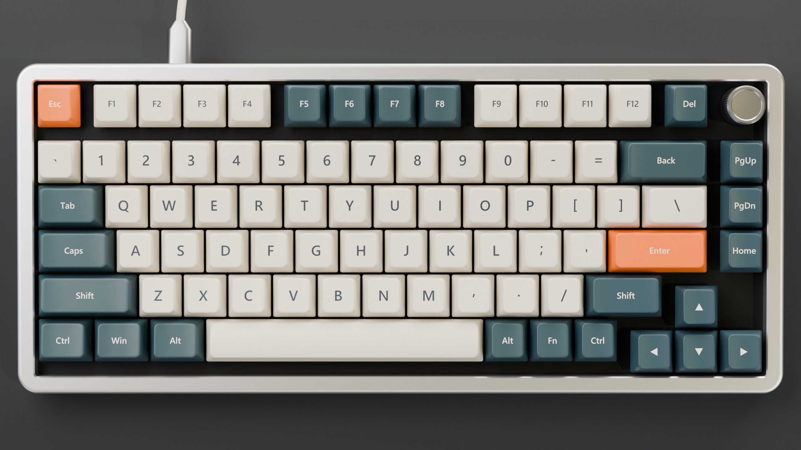

# 机械键盘

一把用 Blender 程序化建模的 75% 机械键盘，外加一个可以实际敲的网页版：按键有弹簧物理，键帽能拔下来乱飞，声音全部由程序合成。


## 运行网页版

```bash
npm install
npm run dev
```

打开 http://localhost:5173 。

- 直接敲实体键盘，或用鼠标点按键
- 右键按键拔下键帽（或打开“拔键帽”后左键点）
- 鼠标停在旋钮上滚滚轮调音量
- 三种轴体音色：线性 Thock / 段落 Clack / 青轴 Click

## 重新建模和渲染

需要 Blender 5.x。`package.json` 里的 `model` 脚本写的是 `D:/Blender/blender.exe`，路径不同请自行修改。

```bash
npm run model
```

会重新生成 `blender/keyboard.blend`、`public/models/keyboard.glb` 和 `renders/` 下的四张图。

## 目录

| 路径 | 内容 |
| --- | --- |
| `blender/build_keyboard.py` | 建模、材质、灯光、渲染、导出 GLB 的完整脚本 |
| `src/main.js` | Three.js 场景、按键弹簧物理、键帽刚体（cannon-es） |
| `src/sound.js` | 音效合成：模态共振 + 带通噪声脉冲，没有录音素材 |
| `renders/` | Cycles 渲染图（2560×1440） |


