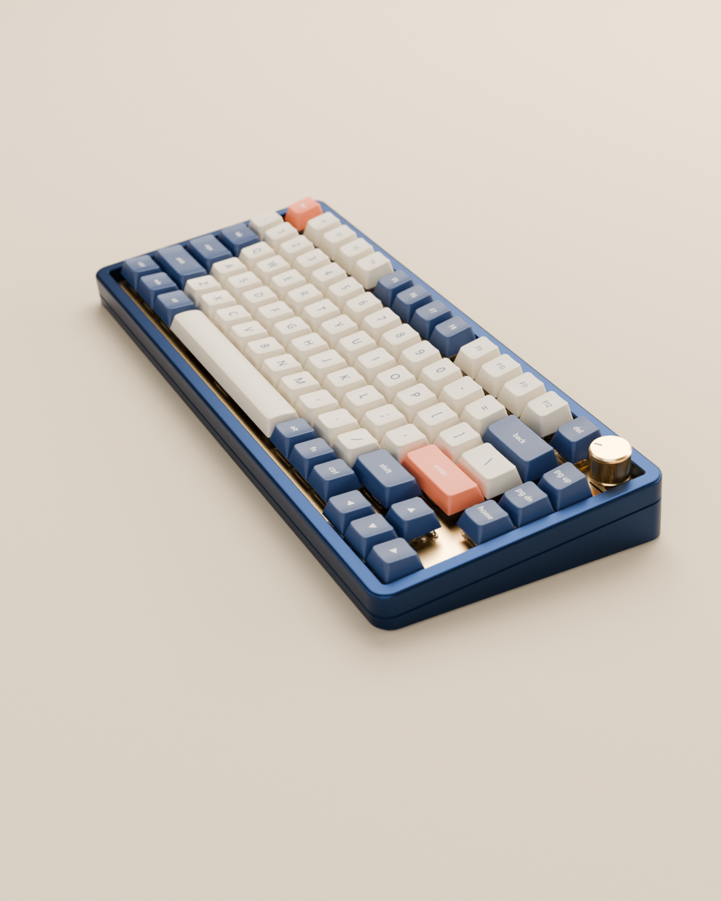
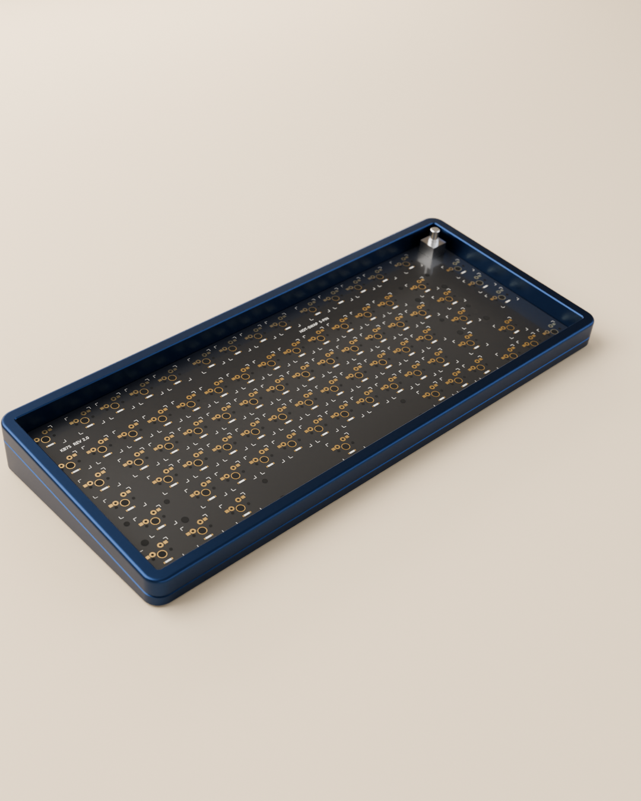
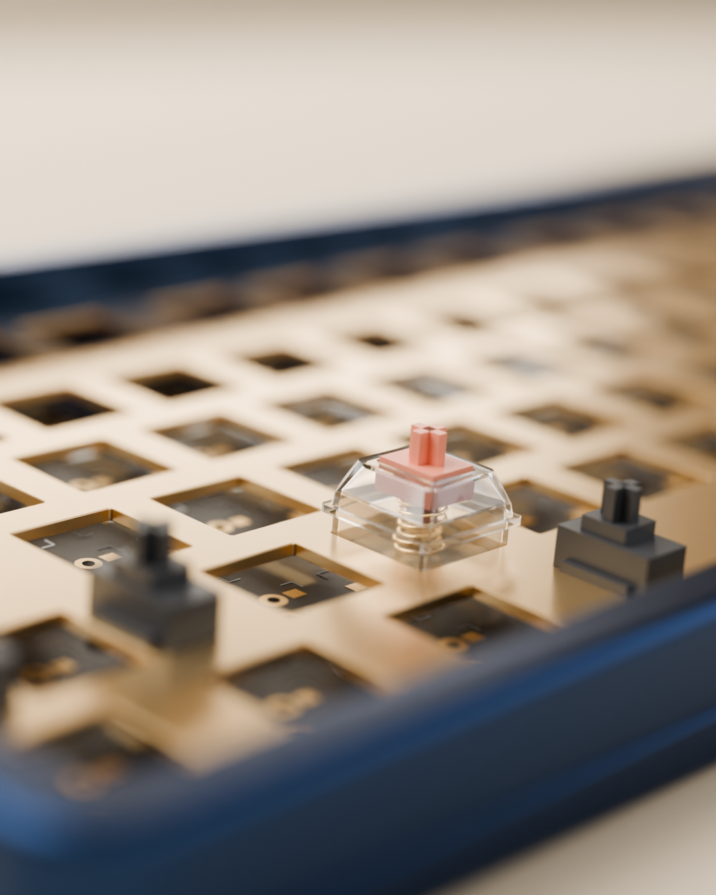
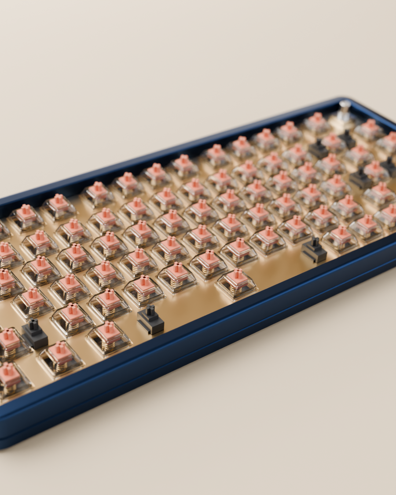
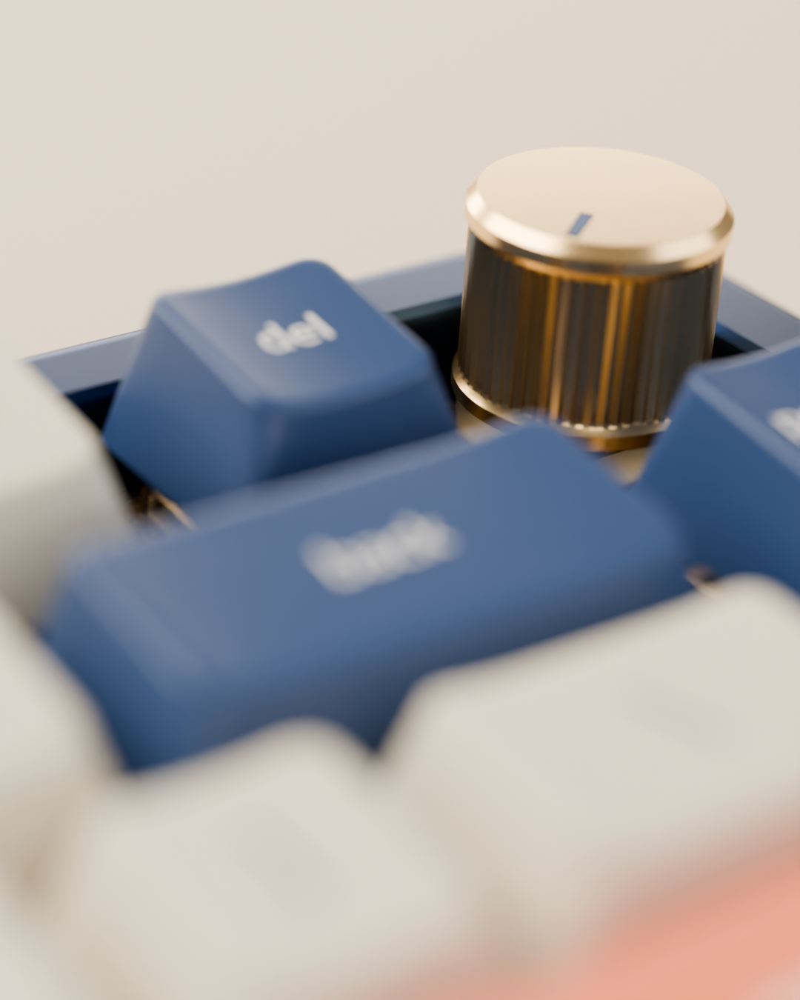

# 机械键盘

一把用 Blender 程序化建模的 75% 机械键盘：藏青阳极氧化外壳、金色定位板、透明轴体、奶白 / 藏青 / 珊瑚三色键帽。附带一支 23 秒的 Cycles 装配动画，和一个可以实际敲的网页版。



装配动画成片：[renders/assembly.mp4](renders/assembly.mp4)（1080×1350，30 帧/秒，7 个镜头：空壳与 PCB → 定位板落下 → 第一颗轴特写 → 轴体下雨 → 铺键帽 → 旋钮 → 敲击波纹与全景）。

| | |
| --- | --- |
|  |  |
|  |  |

## 运行网页版

```bash
npm install
npm run dev
```

打开 http://localhost:5173 。

- 打开页面先实时播放一遍装配动画（点任意处或按任意键跳过，“重播装配”可以再看）
- 直接敲实体键盘，或用鼠标点按键；轴心和弹簧会跟着压下去
- 右键按键拔下键帽看轴体（或打开“拔键帽”后左键点）
- 鼠标停在旋钮上滚滚轮调音量
- 三种轴体音色：线性 Thock / 段落 Clack / 青轴 Click

## 重新建模和渲染

需要 Blender 5.x 和 ffmpeg。`package.json` 里写的是 `D:/Blender/blender.exe`，路径不同请自行修改。

```bash
npm run model
```

重新生成 `blender/keyboard.blend`（含动画）和 `public/models/keyboard.glb`。

```bash
npm run film
```

渲染全部 690 帧到 `renders/frames/` 并合成 `renders/assembly.mp4`。已经渲过的帧会跳过，中断后可以接着渲；RTX 5080 上大约 50 分钟。

只想出几张单帧：

```bash
"D:/Blender/blender.exe" -b -P blender/build_keyboard.py -- --no-export --stills hero:690,switch:96 --samples 256
```

## 目录

| 路径 | 内容 |
| --- | --- |
| `blender/build_keyboard.py` | 建模、材质、灯光、装配动画、相机、渲染、导出 GLB 的完整脚本 |
| `src/main.js` | Three.js 场景、装配动画、按键弹簧物理、键帽刚体（cannon-es）、景深与环境光遮蔽 |
| `src/sound.js` | 音效合成：模态共振 + 带通噪声脉冲，没有录音素材 |
| `renders/` | Cycles 成片和单帧 |
